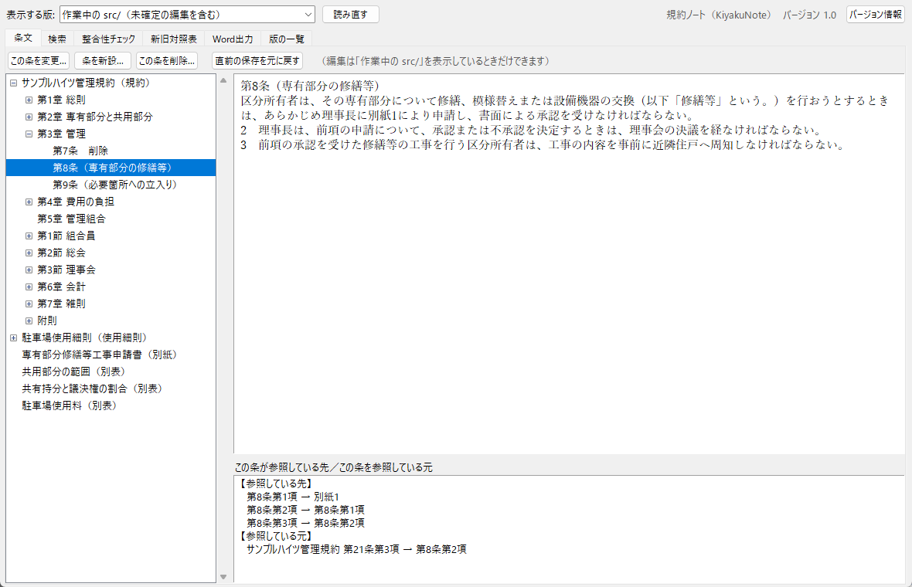
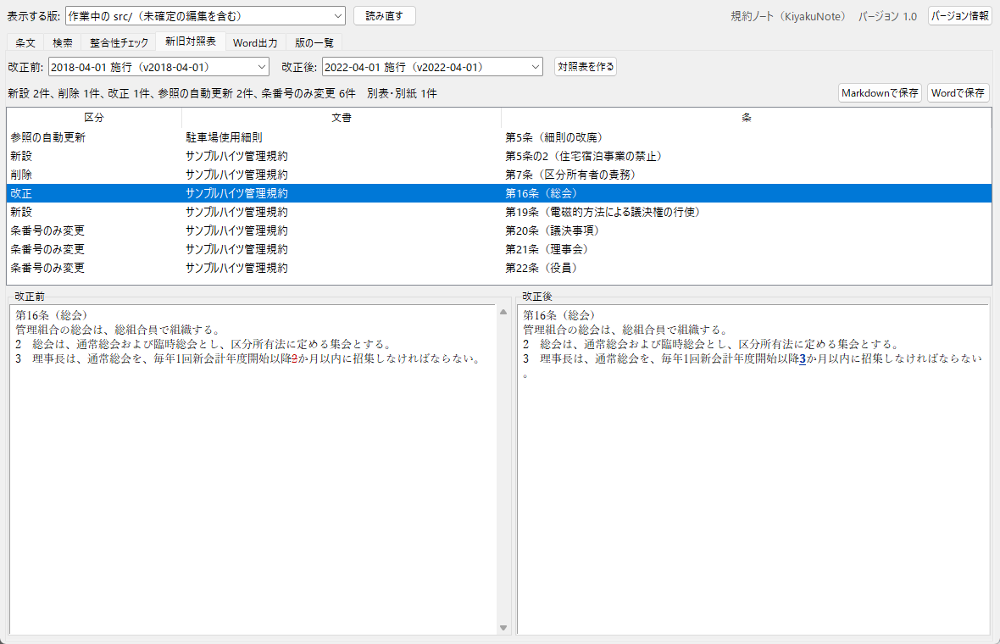

# 規約ノート（KiyakuNote）

**マンション管理規約 編集・改正履歴管理システム** — バージョン 1.0

マンション管理規約（細則・使用細則を含む）を **Markdown + git** で管理し、条文の追加・削除・変更、
**新旧対照表の自動生成**、**参照条項の自動更新**、検索、Word 出力ができる、Windows 向けのオープンソースのツールです。



## 特長

- **条番号を識別子にしない。** 各条・項・号に不変の ID を付け、参照も ID で書きます。番号は出力のときに計算します。
  条の追加・削除で番号が動いても、文中の「第○条第△項」は自動で追随します。
- **新旧対照表を自動で作る。** 2つの版を選ぶと、新設・削除・改正・参照の自動更新・条番号のみ変更に分けて、
  変更箇所を取消線・太字で示した表を作ります（Markdown / Word）。
- **版（改正）の管理。** 総会決議日・施行日の単位で版を持ち、「ある日に有効だった条文」を取り出せます（git のタグを使います）。
- **整合性チェック。** 参照切れ、ID の重複、削除済みの条への参照、番号の直書きを検出します。
- **検索。** 条・項・号・別表の全文検索（SQLite FTS5）。版を指定して過去の規約も検索できます。
- **Word（.docx）出力。** 規約・細則・別表・別紙を Word にします。
- **GUI。** コマンドを打たずに、Windows の画面で閲覧・検索・編集・対照表・版の登録ができます。
- 枝番（第5条の2、項の「４の２」、号の「（３）の２」）、削除条（番号の枠を残す）、附則の「１．」形式の項に対応。

## ダウンロード

[Releases](https://github.com/prismpepe/KiyakuNote/releases) の `KiyakuNote-1.0-win.zip`（Windows 用の exe 版。Python は不要）を展開して、
`KiyakuNote\KiyakuNote.exe` を起動します。署名のない exe なので、初回は Windows の警告（SmartScreen）が出ることがあります
（「詳細情報」→「実行」）。ソースから動かすときは下の「クイックスタート」です。
過去の版（git のタグ）を使う機能は、リポジトリをクローンしたときに使えます（exe 版の zip には git の履歴が入っていません）。

## 動作環境

- Python 3.10 以上（tkinter 付き。Windows 版の標準の Python で入っています）
- git（版の管理・過去の版の取り出しに使います）
- `pip install python-docx`（Word 出力に使います。ほかの外部ライブラリは要りません）

## クイックスタート

```bash
git clone https://github.com/prismpepe/KiyakuNote.git
cd KiyakuNote
pip install -r requirements.txt

python -m kiyakunote lint src                            # 整合性チェック
python -m kiyakunote build src -o out/build              # 番号・参照を展開した Markdown を出す
python -m kiyakunote compare @2018-04-01 @2022-04-01 -o out/対照表.md   # 新旧対照表
python -m kiyakunote search 駐車場 --at @2018-04-01     # 過去の版を検索
python -m kiyakunote gui                                 # 画面を開く（run_gui.bat でも可）
```

`src/` には、**架空のマンション「サンプルハイツ」の管理規約**（2018年制定・2022年改正の2版）と駐車場使用細則が
入っています。すべて架空の内容で、実在の規約・団体とは関係ありません。



## 自分の規約に使うには

1. **非公開のリポジトリ**を作り、このツールのコードを入れて `src/` を自分の規約に置き換えます
   （実データを公開リポジトリに入れないでください。`.gitignore` の `private/` も使えます）。
2. 記法は [docs/仕様書.md](docs/仕様書.md)、操作は [docs/取扱説明書.md](docs/取扱説明書.md) を見てください。
3. 既存の規約（Word・PDF・テキスト）を Markdown に移す作業は手作業です。条の分割・ID の付与・参照の置き換えを
   助ける `python -m kiyakunote.idify`（「前条」「第5条第2項」などを ID の参照に変換）があります。

## ドキュメント

- [簡易仕様書](docs/仕様書.md) — データ形式、記法、番号の計算、参照、版、チェックの内容
- [取扱説明書](docs/取扱説明書.md) — インストール、GUI と CLI の使い方、改正の手順、スクリーンショット

## 注意

- **法的助言ではありません。** 規約の改正は、区分所有法・規約の定める決議（総会の特別決議など）と、必要に応じて
  専門家（マンション管理士・弁護士）の確認が必要です。このツールの出力を、そのまま正式な文書として扱わないでください。
- 無保証です（[LICENSE](LICENSE)）。出力は、必ず人が原文と照らして確かめてください。
- 条文の読み取り（OCR など）の機能は含めていません。

## ライセンス

[MIT License](LICENSE)。サンプルの規約（`src/`、`tests/fixtures/`）は CC0 として自由に使えます。
同梱していない依存ライブラリのライセンスは [THIRD_PARTY_NOTICES.md](THIRD_PARTY_NOTICES.md) を見てください。

## 開発

```bash
python -m pytest -q          # テスト
python build_exe.py          # GUI を exe にする（PyInstaller が必要）
python tools/take_screenshots.py   # docs/images/ のスクリーンショットを作り直す（Pillow が必要）
```

貢献のしかたは [CONTRIBUTING.md](CONTRIBUTING.md) を見てください。
