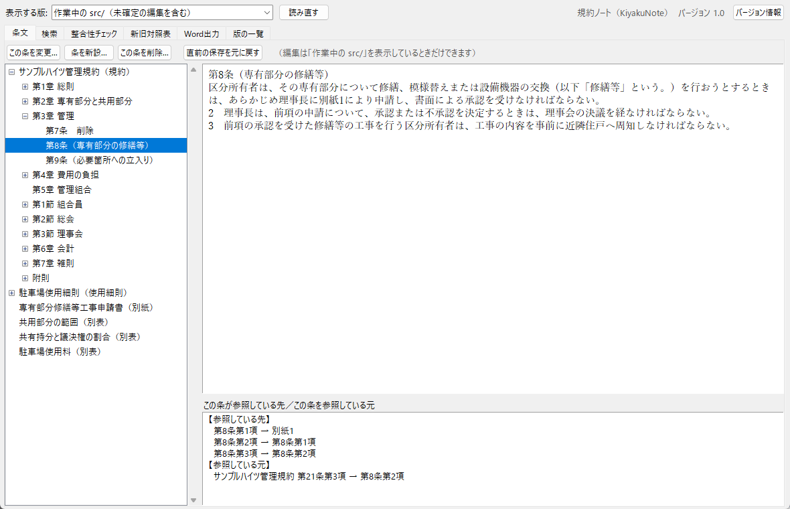
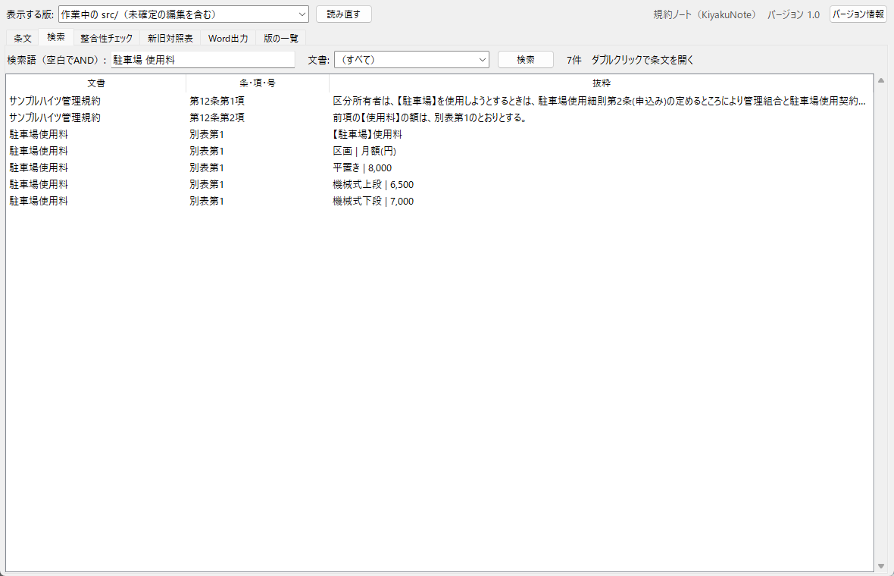
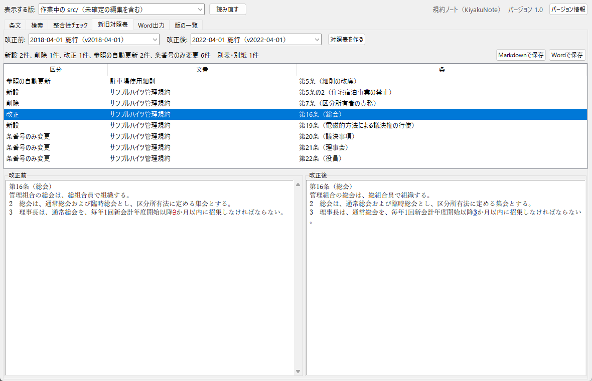

# 取扱説明書

規約ノート（KiyakuNote）の使い方です。画面の例は、同梱の架空の規約「サンプルハイツ」です。
記法の詳細は [仕様書](仕様書.md) を見てください。

## 1. 用意するもの

| 必要なもの | 説明 |
|------------|------|
| Python 3.10 以上 | tkinter（画面部品）つきのもの。python.org の Windows 版には入っています |
| git | 版の管理と、過去の版の取り出しに使います |
| python-docx | `pip install -r requirements.txt`（Word 出力に使います） |

git の利用者名とメールアドレスを、一度だけ設定しておきます（変更の記録・版の登録で使います）。

```bash
git config --global user.name "名前"
git config --global user.email "メールアドレス"
```

## 2. 起動

- **画面**: `run_gui.bat` をダブルクリック（または `python -m kiyakunote gui`、`KiyakuNote.pyw` をダブルクリック）。
- **コマンド**: プロジェクトのフォルダ（`src/` がある所）で `python -m kiyakunote …`。
- exe にしたいときは `build_exe.bat`（PyInstaller が必要）。exe は**作った時点のプログラムのまま**で、
  プログラムを更新したら作り直します。exe はプロジェクトのフォルダの中に置いたまま使います（過去の版を引くのに `.git` を使うため）。

## 3. 画面の使い方

画面の上の「表示する版」で、**作業中の src/**（編集できる）か、条文を持つ過去の版を選びます。過去の版は閲覧・検索・対照表だけです。

### 条文



左の一覧（文書 → 章 → 条）から条を選ぶと、番号と参照を展開した本文と、
「この条が参照している先／この条を参照している元」が出ます。条番号を変える前に、影響を受ける条を確かめるのに使います。

### 検索



語を入れて検索します（空白で AND、全角・半角は区別しません）。ダブルクリックで該当の条を開きます。

### 整合性チェック


参照切れ・ID の重複・削除済みの条への参照（**エラー**）、番号や「前条」の直書き（**警告**）を一覧します。
エラーがあると Word は出せません。警告は、条番号が動くと意味が変わる箇所なので、改正の前に直すのがおすすめです。

### 新旧対照表



「改正前」「改正後」の版を選んで「対照表を作る」。変更の一覧から選ぶと、左右に旧・新の本文が出ます
（削除は赤の取消線、追加は青の太字・下線）。**Wordで保存／Markdownで保存**ができます。
末尾には「要確認の直書き参照」が付きます。

区分の意味: 新設／削除／**改正**（本文の変更）／**参照の自動更新**（本文は同じで、参照する番号だけが動いた）／
**条番号のみ変更**（位置が動いて番号だけが変わった）。

### Word 出力


規約・細則（別表・別紙つき）を `.docx` で出力します。

### 版の一覧


改訂履歴です。「条文を持つ版」は、表示する版や新旧対照表で選べます。

- **変更を記録…**: 変わったファイルを確かめ、説明を入れて git に記録（コミット）します。
- **新しい版として登録…**: 総会の決議日・施行日・タグ名を入れると、いまの内容にタグを付け、`revisions.yaml` に版を足します。

## 4. 条を直す

「条文」タブで条を選び、**この条を変更…**（作業中の版のときだけ）。


編集画面の本文は、1行が1つの項・号です。

```
項 {#art-repair-p1} 区分所有者は、…        ← 第1項
項 {#art-repair-p2} …                        ← 第2項
号 {#art-fee-p1-i1} …                        ← （１）
細 …                                          ← ア．
```

- 行頭の語は「項」「号」「細」「目」。`{#…}` は ID なので**変えません**（新しい行は省略すれば自動で付きます）。
- 他の条を指すときは「**参照を挿入…**」で、条名や本文の一部から探して選びます。番号は自動で付き、条の追加・削除で動いても追随します。
- 「出力のプレビュー」で、番号・参照を展開した結果を保存の前に確かめられます。
- **条を新設…**: 直前の条、枝番にするか、見出し、本文を入れます。枝番なら以降の条番号は動きません。ID は自動で付きます。
- **この条を削除…**: 「第N条　削除」として番号の枠と ID を残します。その条を参照している箇所は、整合性チェックでエラーになります。
- 保存すると自動で読み直します。誤って保存したときは「直前の保存を元に戻す」（画面を開いている間の保存に限ります。閉じたあとは git で戻します）。

## 5. 規約を改正する手順

1. 変更の記録: **ブランチを切る**（git）か、いまの状態を記録しておく。
2. 「条文」タブで条を変更・新設・削除する（または `src/` の Markdown を直接編集する）。
3. 「整合性チェック」でエラーがないことを確かめる。警告（直書きの参照）は ID の参照に直す。
4. 「新旧対照表」で、改正前（現行の版）と改正後（作業中）を選んで対照表を作り、確かめる。総会の議案に付ける資料になります。
5. 総会で決議され、施行日が決まったら、「版の一覧」→「新しい版として登録…」で版を登録する。
6. 「Word出力」で、新しい規約の Word を作る。

コマンドで行うときは次のとおりです。

```bash
python -m kiyakunote lint src
python -m kiyakunote compare @2022-04-01 WORKTREE -o out/対照表.docx     # 現行の版 → 作業中
git add -A && git commit -m "改正案"
git tag v2027-04-01                                                      # 版の登録は revisions.yaml にも書く（GUI なら自動）
python -m kiyakunote docx src -o out/docx
```

## 6. コマンド一覧

| コマンド | 内容 |
|----------|------|
| `python -m kiyakunote lint src` | 整合性チェック |
| `python -m kiyakunote build src -o out` | 番号・参照を展開した Markdown を出力 |
| `python -m kiyakunote docx src -o out/docx [--doc kiyaku]` | Word 出力 |
| `python -m kiyakunote compare 旧 新 -o 対照表.md` | 新旧対照表（`.docx` なら Word）。旧・新は `WORKTREE`、`@2022-04-01`、git のタグなど |
| `python -m kiyakunote revisions` | 版の一覧 |
| `python -m kiyakunote search 語… [--at @日付] [--doc 文書] [--kind 種類] [--level 単位]` | 検索 |
| `python -m kiyakunote refs 条ID` | その条が参照している先と、参照している元 |
| `python -m kiyakunote index [--at @日付]` | 検索の索引を作り直す |
| `python -m kiyakunote gui` | 画面を開く |
| `python -m kiyakunote.idify [src] [--doc kiyaku] [--dry]` | 本文の「前条」「第5条第2項」などを ID の参照に変換（`--dry` は確認のみ） |

検索の索引（`out/search.db`）は、正本から作る使い捨てのファイルです。版を変えて検索すると、自動で作り直します。

## 7. 自分の規約に使う

1. **非公開の**リポジトリを作り、このツール（`kiyakunote/` など）を入れます。実在の規約を公開リポジトリに入れないでください。
2. `src/` のサンプルを消し、自分の規約を [仕様書](仕様書.md) の記法で書きます。まず1つの規約と1つの細則で試すのがおすすめです。
   - 条・項・号に ID を付ける（`{#art-xxx}`）。
   - 本文の「第○条」「前条」は、`{ref:…}` に置き換える。`python -m kiyakunote.idify` が、「前条」「第5条第2項」の形を機械的に変換します
     （確実に解決できるものだけ。`--dry` で確認してから。ファイルを書き換えるので、`git diff` で確かめてください）。
   - 別表・別紙は別ファイルにして、親の `appendices` に並べる。
3. `python -m kiyakunote lint src` が通るまで直す。
4. 出力した規約を、**手元の原本と照らして確かめる**。
5. 版の登録: 現行の規約にタグを付け、`revisions.yaml` に決議日・施行日・タグを書く（GUI の「新しい版として登録…」でも可）。
6. 過去の版が必要なら、過去の規約を同じ手順で作り、その施行日のタグを付ける。

## 8. よくある質問

**画面が出ない／すぐ落ちる。** `python -m kiyakunote gui` をコマンドで実行して、エラーを見てください。
exe の場合は、exe を作り直してください（プログラムを更新したとき）。

**「条文を持つ版がない」と出る。** 指定した日に有効な版に、タグ（`ref`）が付いていません。`revisions.yaml` の `ref` に、
その版のタグを書いてください。

**番号がずれる。** 条の順序が変わった、または `branch` の指定が違うかもしれません。`python -m kiyakunote build src -o out` で出力して確かめます。

**git の利用者名が未設定と出る。** 「1. 用意するもの」の `git config` を実行します。

**Word の書式を変えたい。** `kiyakunote/docx_out.py` が書式を決めています（フォント、余白、見出しの形）。

## 9. 免責

このツールは、規約の保守を助けるものです。**出力の正確さは保証しません。**
規約の改正には、区分所有法と規約に定める決議が必要です。必要に応じて、マンション管理士・弁護士などの専門家に確認してください。
