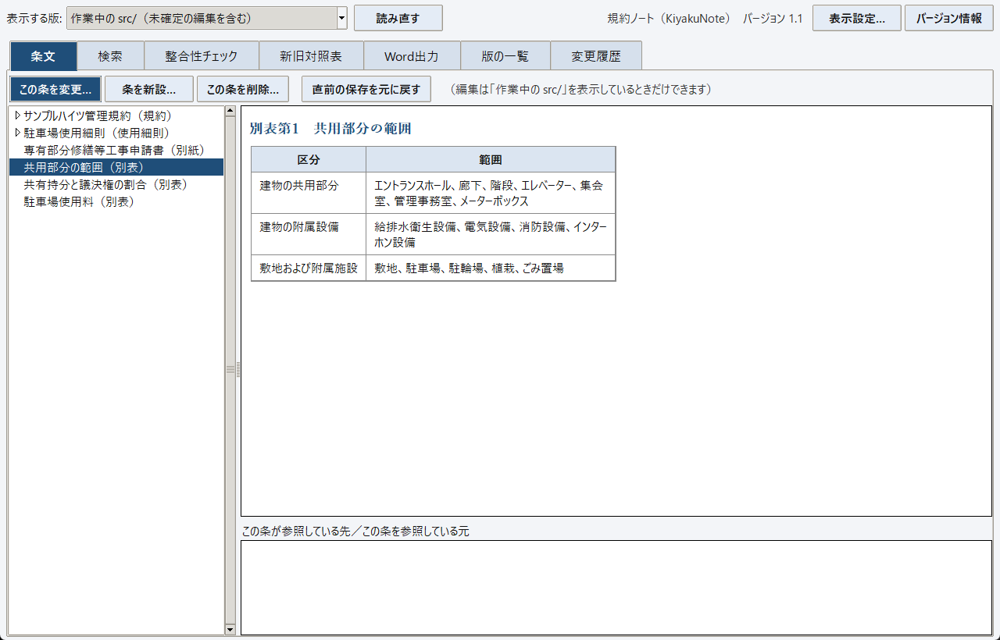
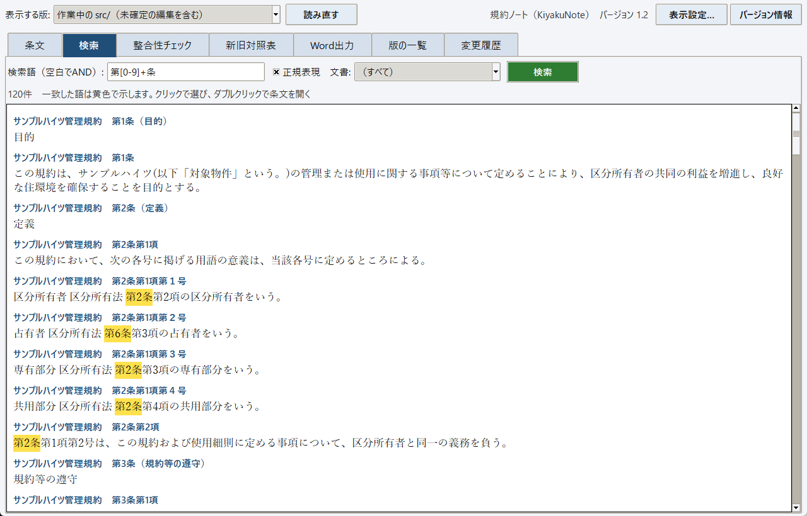
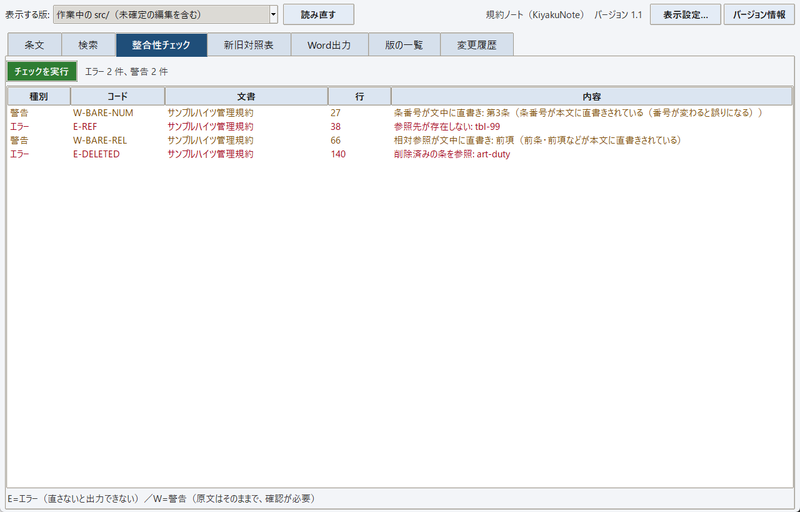
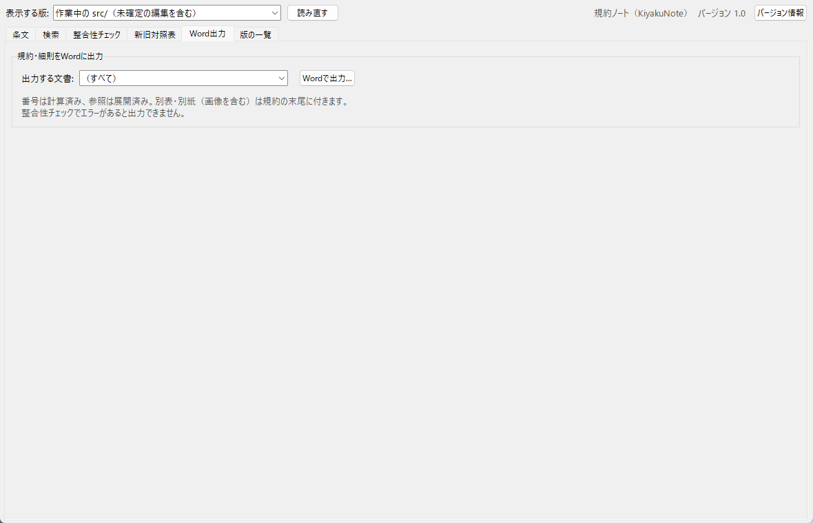
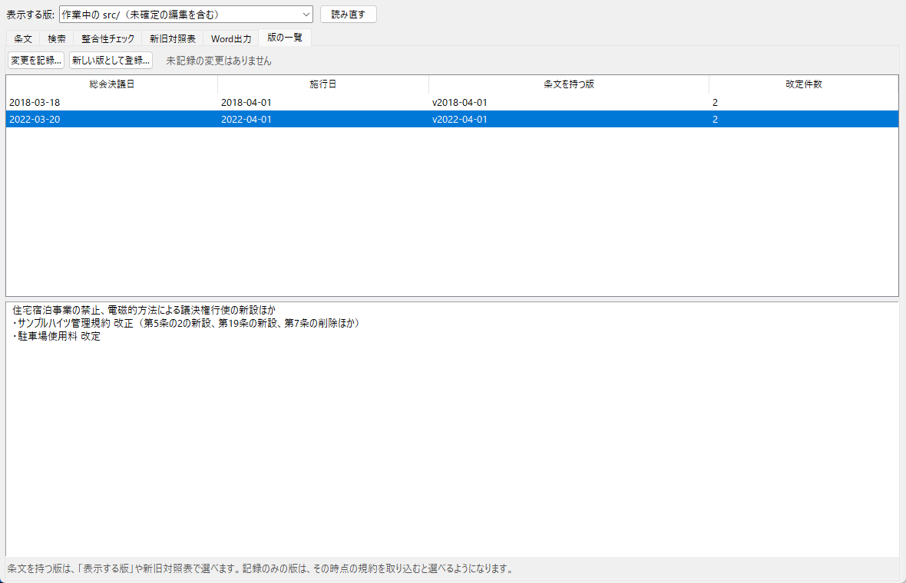
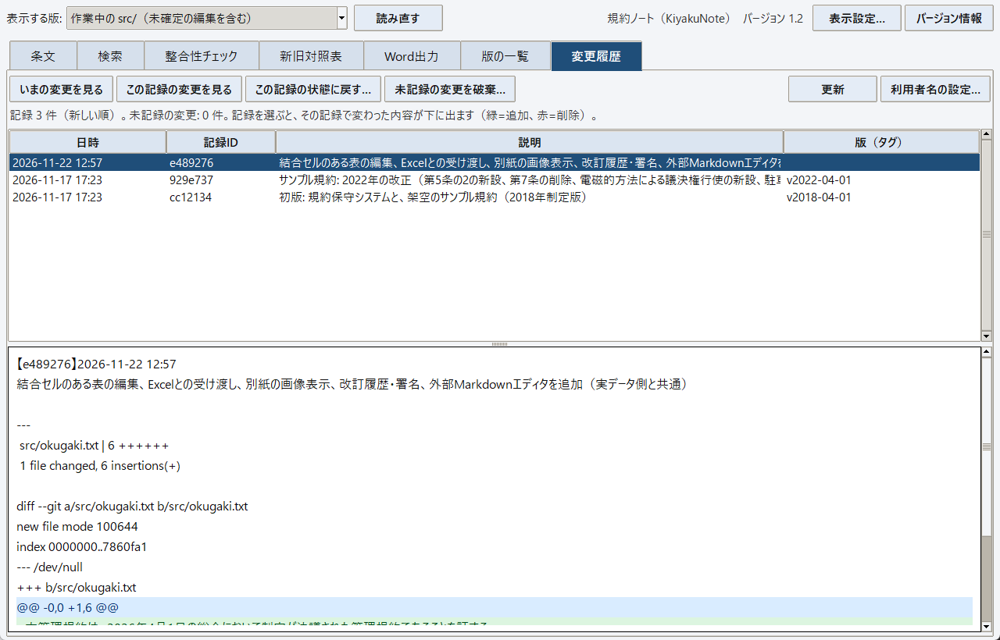
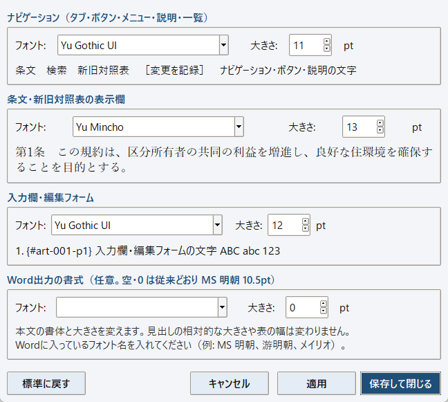
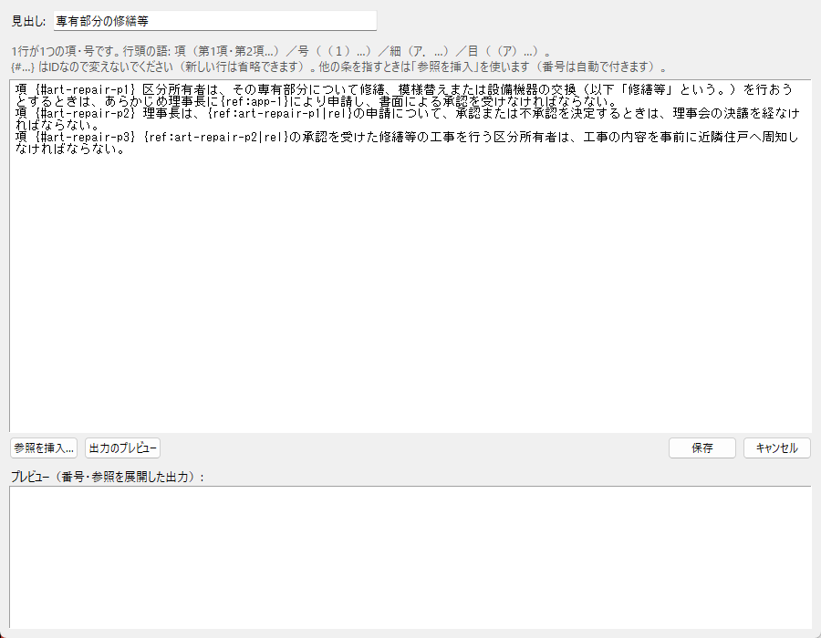

# 取扱説明書

規約ノート（KiyakuNote）の使い方です。画面の例は、同梱の架空の規約「サンプルハイツ」です。
記法の詳細は [仕様書](仕様書.md) を見てください。

## 1. 用意するもの

| 必要なもの | 説明 |
|------------|------|
| Python 3.10 以上 | tkinter（画面部品）つきのもの。python.org の Windows 版には入っています |
| git | 版の管理と、過去の版の取り出しに使います |
| python-docx | `pip install -r requirements.txt`（Word 出力に使います） |

git の利用者名とメールアドレスを、一度だけ設定しておきます（変更の記録・版の登録で使います）。

```bash
git config --global user.name "名前"
git config --global user.email "メールアドレス"
```

## 2. 起動

- **画面**: `run_gui.bat` をダブルクリック（または `python -m kiyakunote gui`、`KiyakuNote.pyw` をダブルクリック）。
- **コマンド**: プロジェクトのフォルダ（`src/` がある所）で `python -m kiyakunote …`。
- exe にしたいときは `build_exe.bat`（PyInstaller が必要）。exe は**作った時点のプログラムのまま**で、
  プログラムを更新したら作り直します。exe はプロジェクトのフォルダの中に置いたまま使います（過去の版を引くのに `.git` を使うため）。

## 3. 画面の使い方

画面の上の「表示する版」で、**作業中の src/**（編集できる）か、条文を持つ過去の版を選びます。過去の版は閲覧・検索・対照表だけです。

### 条文


左の一覧（文書 → 章 → 条）から条を選ぶと、番号と参照を展開した本文と、
「この条が参照している先／この条を参照している元」が出ます。条番号を変える前に、影響を受ける条を確かめるのに使います。

別表・別紙を選ぶと、罫線つきの表で表示されます（結合セルにも対応）。別紙・別図は画像で表示します。一覧の末尾には、巻末の**改訂履歴**と**理事長の署名（奥書）**も項目として出ます。



### 検索


語を入れて検索します（空白で AND、全角・半角は区別しません）。**一致した語は黄色のマーカー**で示します。
「**正規表現**」にチェックを入れると、検索語全体を正規表現として使えます（例: `第[0-9]+条の[0-9]+`。空白は区切りではなく式の一部。大文字・小文字は区別しません）。
クリックで選び、ダブルクリックで該当の条を開きます（開いた条文の中も検索語が黄色になります）。



### 整合性チェック



参照切れ・ID の重複・削除済みの条への参照（**エラー**）、番号や「前条」の直書き（**警告**）を一覧します。
エラーがあると Word は出せません。警告は、条番号が動くと意味が変わる箇所なので、改正の前に直すのがおすすめです。

### 新旧対照表


「改正前」「改正後」の版を選んで「対照表を作る」。変更の一覧から選ぶと、左右に旧・新の本文が出ます
（削除は赤の取消線、追加は青の太字・下線）。**Wordで保存／Markdownで保存**ができます。
末尾には「要確認の直書き参照」が付きます。

区分の意味: 新設／削除／**改正**（本文の変更）／**参照の自動更新**（本文は同じで、参照する番号だけが動いた）／
**条番号のみ変更**（位置が動いて番号だけが変わった）。

### Word 出力



規約・細則（別表・別紙・別図つき）を `.docx` で出力します。「（すべて）」を選ぶと、表紙・目次・中表紙つきの**一冊の管理規約**になります（構成は `src/book.txt`。下の「一冊の管理規約として出力」）。規約には、巻末に改訂履歴の表と理事長の署名（奥書）も付きます。過去の版でも、その版の画像・改訂履歴で出力します。

### 版の一覧



改訂履歴です。「条文を持つ版」は、表示する版や新旧対照表で選べます。

- **変更を記録…**: 変わったファイルを確かめ、説明を入れて git に記録（コミット）します。
- **新しい版として登録…**: 総会の決議日・施行日・タグ名を入れると、いまの内容にタグを付け、`revisions.yaml` に版を足します。
- 記録するときに git の利用者名が未設定なら、設定画面が自動で開きます。

### 編集・新設・削除のボタン（「条文」タブの上のボタン）

左の一覧で選んでいる項目に応じて、**編集…／新設…／削除…** の働きとボタンの名前が変わります。できない操作のボタンは、グレーになって押せません（警告は出ません）。編集は「作業中の src/」のときだけで、過去の版ではすべてグレーです。

| 選んでいる項目 | 編集 | 新設 | 削除 |
|---|---|---|---|
| 条 | 条を編集 | 条を新設（選んだ条の次） | 条を削除 |
| 章・節 | － | 条を新設 | － |
| 文書（規約・細則） | － | 押すと「条を新設／別表等を新設」を選ぶ | － |
| 別表・別紙・別図 | 表を編集（表のとき）／画像を差し替え（画像のとき） | 別表等を新設 | 別表等を削除 |
| 改訂履歴 | 改訂履歴を編集 | － | － |
| 署名（奥書） | 署名を編集 | － | － |

「直前の保存を元に戻す」は、戻せる保存があるときだけ押せます。「Markdownエディタで開く…」は、項目に対応するファイルがあるときだけ押せます。

### 別表・別紙・別図の編集

左の一覧で別表・別紙・別図（一覧の下のほう）を選ぶと、上の「編集／新設／削除」ボタンがその働きになる（下の「編集・新設・削除のボタン」の表を参照）。

- **表を編集…**（編集ボタン）: 表（**結合セルのある表も**）を、画面の表で書き換える。結合セルは大きな枠で出る。青い枠は見出し。セルの中で改行したいところには ↵ を入れる。1つの文書に表が複数あるときは、上で編集する表を選ぶ。
  - **行を上／下に追加・行を削除・列を左／右に追加・列を削除**。いま選んでいる枠を基準にし、結合セルをまたぐ位置に足すと結合セルが広がり、削除すると狭まる（結合セルの行・列では、結合していない枠を選ぶと分かりやすい）。
  - 保存すると、結合セルのある表は HTML の表で、ない表は元の形式（Markdown の `|` の表／HTML の表）で書き戻し、表の外の文章は変えない。
  - **セルの結合**: 枠を選んで「右のセルと結合」「下のセルと結合」（同じ高さ・同じ幅のセルとだけ結合できる。文字はつなげる）、「結合を解除」（文字は左上のセルに残る）。
  - **Excelとの受け渡し**: 「Excelで編集…」で表を一時のブックに書き出して Excel で開く。Excel で書き換えて上書き保存し、画面に戻って「Excelの変更を取り込む」。結合セルは Excel の結合セルとして扱い、見出しは太字・薄い青のセルになる。「Excelファイルに書き出し…」「Excelファイルから取り込み…」で、ファイルを指定しての受け渡しもできる。取り込んでも、画面で「保存」するまで条文のファイルは変わらない。Excel のブックを読み書きするのに `openpyxl` が要る（`pip install openpyxl`）。
- **改訂履歴を編集…**（編集ボタン）: 改訂履歴（`src/revisions.yaml`）を表で編集する。列は 総会決議日・施行日・版のタグ・備考・改定内容（セルの中の ↵ で1件ずつ区切る）。行・列の追加削除や Excel との受け渡しは、表の編集と同じ。日付は `2026-04-19` の形。保存前に形式を確かめる。
- **署名を編集…**（編集ボタン）: 理事長の署名（奥書、`src/okugaki.txt`）を文章で編集する。空行で段落を分ける。空にして保存すると署名の項目は出なくなる。
- **画像を差し替え…**（編集ボタン）: 別紙・別図の画像を、選んだ画像ファイル（png / jpg / gif / webp）に差し替える。新しい画像は `srcssets\` にコピーされる。古い画像のファイルは残す。画像が複数あるときは、何枚目かを聞く。
- **別表等を新設…**: 別表・別紙・別図を新設する。属する文書（既定は規約）、種類、題名を入れ、「表を作る（列・行の数）」か「画像を取り込む」を選ぶ。番号は同じ種類の次の番号が自動で付き、親文書の `appendices` にも自動で加わる。表は、作ったあとに「表を編集…」で書き込む。
- **別表等を削除…**: 番号の枠とIDを残し、本文を空にして「削除」にする（番号は詰めない）。この別表・別紙を参照している箇所は、整合性チェックでエラーになる。
- どれも、保存のあと自動で読み直し、整合性チェックの件数が状態欄に出る。誤ったときは「直前の保存を元に戻す」（新設したファイルも消える。画面を開いている間に限る）。

### 変更履歴



git のコマンドを使わずに、記録（コミット）の履歴を見られます。記録を選ぶと、その記録で変わった内容が下に出ます（緑=追加、赤=削除）。

- **いまの変更を見る**: 未記録の変更の内容（新しいファイルも含む）。
- **この記録の状態に戻す…**: 条文（`src/`）を選んだ記録の状態にします。戻した内容は「未記録の変更」になり、履歴は消えません。よければ「変更を記録」で記録します（未記録の変更があるときは戻せません）。
- **未記録の変更を破棄…**: 最後に記録した状態に戻します。**元に戻せない**ので、確認が出ます。
- **利用者名の設定…**: 記録に残る名前とメールアドレスを設定します。

### 表示設定



右上の「**表示設定…**」で、ナビゲーション（タブ・ボタン・説明・一覧）、条文・新旧対照表の表示欄、入力欄・編集フォームの**フォントの種類と大きさ**を変えられます（「適用」で確認、「保存して閉じる」で保存、「標準に戻す」もあります）。**Word 出力の書式**（本文のフォントと大きさ。空は従来どおり MS 明朝 10.5pt）も設定できます。設定は利用者ごとに `%APPDATA%\KiyakuNote\settings.json` に保存されます（プロジェクトの外）。

### 一冊の管理規約として出力（Word出力タブ）

「出力する文書」で「（すべて）」を選ぶと、文書ごとの個別のファイルではなく、**一冊の管理規約**（`〇〇（全体）.docx`）として出力する。表紙、目次、中表紙（管理規約・別表・別紙・別図・使用細則・細則）、各文書、巻末の改訂履歴・署名の順になる。文書ごとの個別のファイルが欲しいときは、「一冊にまとめず…」にチェックを入れる。

- **構成は `src/book.txt`**（印刷専用のデータ。条文には影響しない）。無ければ、文書から既定の構成を作る。「**冊子の構成を編集…**」で、順番の入れ替えや、表紙・中表紙の文字の変更ができる（「既定の構成にする」「確認」もある）。
- 書き方（1行が1項目、`#` は注釈）: `表紙: 題名`（1行目が大きな題名、以降は副題）／`目次`／`中表紙: 題名`／`文書: 文書ID`／`別表等: 文書ID`（その文書の別表・別紙・別図）／`改訂履歴`／`署名`。
- 目次はWordの目次（フィールド）で、Wordで開くと「フィールドを更新しますか」と聞かれる。「はい」を選ぶとページ番号が入る。
- 文書が構成に入っていないときや、2回入っているときは、出力の前に知らせる。存在しない文書IDはエラー。
- コマンド: `python -m kiyakunote docx src --book -o out`。

### 外部の Markdown エディタで編集（「条文」タブの右上）

- 左の一覧で項目（文書・条・別表・別紙・改訂履歴・署名）を選び、**Markdownエディタで開く…** を押すと、その項目のファイルを外部のエディタ（Handy Markdown Editor など）で開く。エディタで保存すると、画面が自動で読み直す。編集は「作業中の src/」のときだけ。
- エディタは「表示設定…」の「Markdownエディタ」で指定する（`MarkdownEditor.exe` を選ぶ）。空のときは Windows の既定のアプリで開く。
- 改訂履歴の項目は `src/revisions.yaml`、署名（奥書）の項目は `src/okugaki.txt`（文章。空行で段落を分ける）が対応するファイル。

### 巻末の項目（改訂履歴・署名）

- **改訂履歴**は `src/revisions.yaml` から作る。過去の版を表示しているときは、その版の施行日までの分だけを出す。
- **署名（奥書）**は `src/okugaki.txt` に書く（無ければこの項目は出ない）。過去の版では、そのタグに入っている `okugaki.txt` を使う。
- Word出力では、規約の別表・別紙・別図の後ろに、改訂履歴の表と署名が付く。

### 巻末の項目（改訂履歴・署名）

- **改訂履歴**は `src/revisions.yaml` から作る。過去の版を表示しているときは、その版の施行日までの分だけを出す。
- **署名（奥書）**は `src/okugaki.txt` に書く（無ければこの項目は出ない）。過去の版では、そのタグに入っている `okugaki.txt` を使う。
- Word出力では、規約の別表・別紙・別図の後ろに、改訂履歴の表と署名が付く。


## 4. 条を直す

「条文」タブで条を選び、**編集…**（作業中の版のときだけ）。



編集画面の本文は、1行が1つの項・号です。

```
項 {#art-repair-p1} 区分所有者は、…        ← 第1項
項 {#art-repair-p2} …                        ← 第2項
号 {#art-fee-p1-i1} …                        ← （１）
細 …                                          ← ア．
```

- 行頭の語は「項」「号」「細」「目」。`{#…}` は ID なので**変えません**（新しい行は省略すれば自動で付きます）。
- 他の条を指すときは「**参照を挿入…**」で、条名や本文の一部から探して選びます。番号は自動で付き、条の追加・削除で動いても追随します。
- 「出力のプレビュー」で、番号・参照を展開した結果を保存の前に確かめられます。
- **新設…**（条を選んだとき「条を新設」）: 直前の条、枝番にするか、見出し、本文を入れます。枝番なら以降の条番号は動きません。ID は自動で付きます。
- **この条を削除…**: 「第N条　削除」として番号の枠と ID を残します。その条を参照している箇所は、整合性チェックでエラーになります。
- 保存すると自動で読み直します。誤って保存したときは「直前の保存を元に戻す」（画面を開いている間の保存に限ります。閉じたあとは「変更履歴」タブの「この記録の状態に戻す」で戻せます）。

## 5. 規約を改正する手順

1. 変更の記録: **ブランチを切る**（git）か、いまの状態を記録しておく。
2. 「条文」タブで条を変更・新設・削除する（または `src/` の Markdown を直接編集する）。
3. 「整合性チェック」でエラーがないことを確かめる。警告（直書きの参照）は ID の参照に直す。
4. 「新旧対照表」で、改正前（現行の版）と改正後（作業中）を選んで対照表を作り、確かめる。総会の議案に付ける資料になります。
5. 総会で決議され、施行日が決まったら、「版の一覧」→「新しい版として登録…」で版を登録する。
6. 「Word出力」で、新しい規約の Word を作る。

コマンドで行うときは次のとおりです。

```bash
python -m kiyakunote lint src
python -m kiyakunote compare @2022-04-01 WORKTREE -o out/対照表.docx     # 現行の版 → 作業中
git add -A && git commit -m "改正案"
git tag v2027-04-01                                                      # 版の登録は revisions.yaml にも書く（GUI なら自動）
python -m kiyakunote docx src -o out/docx
```

## 6. コマンド一覧

| コマンド | 内容 |
|----------|------|
| `python -m kiyakunote lint src` | 整合性チェック |
| `python -m kiyakunote build src -o out` | 番号・参照を展開した Markdown を出力 |
| `python -m kiyakunote docx src -o out/docx [--doc kiyaku]` | Word 出力 |
| `python -m kiyakunote compare 旧 新 -o 対照表.md` | 新旧対照表（`.docx` なら Word）。旧・新は `WORKTREE`、`@2022-04-01`、git のタグなど |
| `python -m kiyakunote revisions` | 版の一覧 |
| `python -m kiyakunote search 語… [--at @日付] [--doc 文書] [--kind 種類] [--level 単位]` | 検索 |
| `python -m kiyakunote refs 条ID` | その条が参照している先と、参照している元 |
| `python -m kiyakunote index [--at @日付]` | 検索の索引を作り直す |
| `python -m kiyakunote gui` | 画面を開く |
| `python -m kiyakunote.idify [src] [--doc kiyaku] [--dry]` | 本文の「前条」「第5条第2項」などを ID の参照に変換（`--dry` は確認のみ） |

検索の索引（`out/search.db`）は、正本から作る使い捨てのファイルです。版を変えて検索すると、自動で作り直します。

## 7. 自分の規約に使う

1. **非公開の**リポジトリを作り、このツール（`kiyakunote/` など）を入れます。実在の規約を公開リポジトリに入れないでください。
2. `src/` のサンプルを消し、自分の規約を [仕様書](仕様書.md) の記法で書きます。まず1つの規約と1つの細則で試すのがおすすめです。
   - 条・項・号に ID を付ける（`{#art-xxx}`）。
   - 本文の「第○条」「前条」は、`{ref:…}` に置き換える。`python -m kiyakunote.idify` が、「前条」「第5条第2項」の形を機械的に変換します
     （確実に解決できるものだけ。`--dry` で確認してから。ファイルを書き換えるので、`git diff` で確かめてください）。
   - 別表・別紙は別ファイルにして、親の `appendices` に並べる。
3. `python -m kiyakunote lint src` が通るまで直す。
4. 出力した規約を、**手元の原本と照らして確かめる**。
5. 版の登録: 現行の規約にタグを付け、`revisions.yaml` に決議日・施行日・タグを書く（GUI の「新しい版として登録…」でも可）。
6. 過去の版が必要なら、過去の規約を同じ手順で作り、その施行日のタグを付ける。

## 8. よくある質問

**画面が出ない／すぐ落ちる。** `python -m kiyakunote gui` をコマンドで実行して、エラーを見てください。
exe の場合は、exe を作り直してください（プログラムを更新したとき）。

**「条文を持つ版がない」と出る。** 指定した日に有効な版に、タグ（`ref`）が付いていません。`revisions.yaml` の `ref` に、
その版のタグを書いてください。

**番号がずれる。** 条の順序が変わった、または `branch` の指定が違うかもしれません。`python -m kiyakunote build src -o out` で出力して確かめます。

**git の利用者名が未設定と出る。** 「1. 用意するもの」の `git config` を実行します。

**Word の書式を変えたい。** `kiyakunote/docx_out.py` が書式を決めています（フォント、余白、見出しの形）。

## 9. 免責

このツールは、規約の保守を助けるものです。**出力の正確さは保証しません。**
規約の改正には、区分所有法と規約に定める決議が必要です。必要に応じて、マンション管理士・弁護士などの専門家に確認してください。
